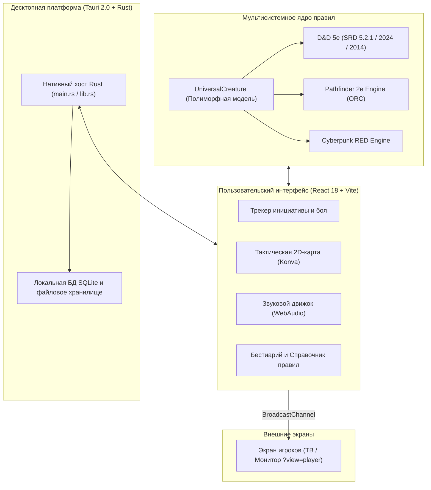

<p align="center">
  
</p>

<h1 align="center">TTRPG Helper</h1>

<p align="center">
  <strong>100% Offline-First Multi-System Virtual Tabletop & Combat Manager</strong><br>
  <em>Автономный настольный боевой трекер и центр управления сессиями для Мастеров и Игроков НРИ</em>
</p>

<p align="center">
  
  <a href="https://discord.gg/XYQSHWVAuE"></a>
  
  
  
  
  
</p>

<p align="center">
  <strong>Language / Язык:</strong>
  <a href="README.md">🇷🇺 <strong>Русский</strong></a> &bull;
  <a href="README_EN.md">🇬🇧 <strong>English</strong></a>
</p>

---

## Навигация

- [О проекте](#о-проекте)
- [Поддерживаемые системы правил](#поддерживаемые-системы-правил)
- [Ключевые возможности](#ключевые-возможности)
  - [1. Интерактивная тактическая карта и экран игроков](#1-интерактивная-тактическая-карта-и-экран-игроков)
  - [2. Быстрое цифровое управление боем (Numpad-хоткеи)](#2-быстрое-цифровое-управление-боем-numpad-хоткеи)
  - [3. Бестиарий, заклинания и справочник правил](#3-бестиарий-заклинания-и-справочник-правил)
  - [4. Автономный звуковой движок](#4-автономный-звуковой-движок)
  - [5. Надежность данных, SQLite и Crash Recovery](#5-надежность-данных-sqlite-и-crash-recovery)
- [Архитектура проекта](#архитектура-проекта)
- [Шпаргалка горячих клавиш](#шпаргалка-горячих-клавиш)
- [Установка и сборка](#установка-и-сборка)
- [Структура репозитория](#структура-репозитория)
- [Документация для разработчиков](#документация-для-разработчиков)
- [Лицензии и авторские права](#лицензии-и-авторские-права)

---

## О проекте

**TTRPG Helper** — это высокопроизводительное настольное приложение для Ведущих (Dungeon Masters) и Игроков настольных ролевых игр.

### Главные принципы

- **100% Offline-First**: приложение не зависит от внешних серверов, облачных аккаунтов или интернет-соединения. Все вычисления, боевые логи, базы данных и параметры кампаний хранятся локально на компьютере пользователя.
- **Производительность (Rust + Tauri 2.0)**: нативный бэкенд на Rust обеспечивает минимальное потребление оперативной памяти и мгновенный отклик графического интерфейса React 18.
- **Швейцарский нео-глассморфизм**: темный интерфейс с аппаратным размытием, калиброванной типографикой и цветовым кодированием для различных игровых систем.
- **Поддержка двух экранов**: отдельный интерфейс для Ведущего со служебными параметрами и чистый вывод карты для игроков на втором мониторе или ТВ.

---

## Поддерживаемые системы правил

Архитектура приложения разделяет визуальный интерфейс, универсальную модель существа [`UniversalCreature`](src/types/system.ts#L97-L117) и изолированные системные движки правил [`SystemRuleEngine`](src/types/system.ts#L162-L179):

| Игровая система | Базовый документ / Лицензия | Статус | Ключевые механики ядра | Цветовая тема |
| :--- | :--- | :---: | :--- | :--- |
| **D&D (SRD 5.2.1 / 2024)** | WotC SRD 5.2.1 (CC-BY-4.0) | **Готово** | Правила редакции 2024 года: свойства оружия (Weapon Mastery), состояния Dazed/Incapacitated, числовое истощение (-2/ур), бестиарий и заклинания SRD | Warm Fantasy Gold |
| **D&D (SRD 5.1 / 2014)** | WotC SRD 5.1 (CC-BY-4.0) | **Готово** | Классическая пятая редакция: базовые классы, слоты заклинаний, классический бестиарий SRD и правила усталости (Exhaustion 1–6) | Warm Fantasy Gold |
| **Pathfinder 2e** | Remastered (ORC License) | **Бета** | Экономика 3 действий за раунд, 4 степени успеха (+/-10 и Nat 20/1), инициатива по Восприятию/Скрытности, MAP | Stately Slate Bronze |
| **Cyberpunk RED** | Core Rules (R. Talsorian) | **В разработке** | Инициатива REF + 1d10, броня SP по зонам (Голова/Тело) с абляцией при пробитии, Humanity, пороги ранений | Neon Cyberpunk |
| **Custom / Homebrew** | Пользовательские правила | **Бета** | Произвольные дайсы, настраиваемые пулы ресурсов, гибкие треки состояний | Адаптивная |

> [!NOTE] Полная открытость правил D&D (Creative Commons)
> Все игровые правила, заклинания, статблоки монстров и механики D&D в приложении TTRPG Helper основаны **исключительно на официальных открытых документах System Reference Document (SRD 5.2.1 и SRD 5.1)**, опубликованных компанией Wizards of the Coast LLC под свободной безотзывной лицензией **Creative Commons Attribution 4.0 International (CC-BY-4.0)**. Приложение не содержит закрытых материалов Product Identity (Beholder, Mind Flayer и др.).

---

## Ключевые возможности

### 1. Интерактивная тактическая карта и экран игроков

- **Координатные сетки**:
  - Квадратная сетка (Square Grid).
  - Гексагональная вертикальная сетка (`hex-pointy`).
  - Гексагональная горизонтальная сетка (`hex-flat`).
  - Привязка токенов к центрам и узлам сетки.
- **Токены и миниатюры**:
  - Поддержка размеров от Tiny (0.5x0.5) до Gargantuan (4x4).
  - Радиальное меню быстрого взаимодействия [`TokenQuickActions`](src/components/map/TokenQuickActions.tsx) (урон, лечение, наложение состояний прямо на холсте).
  - Индикация очков здоровья, временных хитов и бейджи активных эффектов.
- **Динамический туман войны (Fog of War) и освещение**:
  - Скрытие неисследованных зон и комнат подземелья.
  - Трассировка лучей видимости (Line of Sight) от персонажей с автоматическим открытием видимых участков.
- **Шаблоны зон поражения заклинаний (AoE Templates)**:
  - Конусы, сферы/круги, прямые линии, кубы.
  - Вращение на 360 градусов, настройка радиуса в футах/клетках и цветовая кодировка стихий.
- **Секретные пины и заметки Мастера**:
  - Размещение интерактивных маркеров на карте с лором, описаниями и ловушками.
  - Переключатель «Секретная метка» (метка видна только в окне мастера и скрыта от игроков).
- **Погодные и атмосферные эффекты**:
  - Анимированные шейдерные оверлеи: Ливень, Метель, Густой туман, Парящие искры пепла.
- **Экран игроков (Player Display)**:
  - Отдельное окно для ТВ или проектора (`?view=player`).
  - Полное скрытие врагов в невидимости/тумане, служебных панелей и подсказок мастера.
  - Свободное управление камерой игроками (перемещение ЛКМ, ПКМ, СКМ, `Space + Drag`, зум колесом).
  - Кнопка мгновенной синхронизации камеры мастера с экраном игроков `[ 📺 Игрокам ]`.

---

### 2. Быстрое цифровое управление боем (Numpad-хоткеи)

Управление ходом боевого столкновения без обязательного использования мыши:
- **`Стрелки Вверх / Вниз`** или **`J / K`**: циклическое переключение активного существа в трекере инициативы.
- **`0–9`** (включая цифровую клавиатуру Numpad): ввод числового значения в буфер действия.
- **`Минус (-)`**: нанесение введенного урона выбранной цели.
- **`Плюс (+)`**: лечение (восстановление очков здоровья).
- **`Слэш (/)`**: назначение временных очков здоровья (Temp HP).
- **`Звездочка (*)`**: быстрый бросок инициативы для выбранного существа.
- **`Пробел`**: передача хода следующему участнику с автоматическим тиком таймера.
- **`Enter`**: подтверждение быстрого действия.
- **`Escape`**: сброс буфера ввода или закрытие модальных окон.

---

### 3. Бестиарий, заклинания и справочник правил

- **Встроенная база данных**:
  - Более 300 монстров из D&D 5e SRD 5.2.1 и правил 2024 года.
  - Готовые профили атак, спасбросков, иммунитетов, уязвимостей и заклинаний.
  - Добавление существ в активный бой в один клик.
- **Интерактивная шпаргалка правил (Rules Cheat Sheet)** по клавише **`F1`**:
  - Виды/расы D&D 2024 (Aasimar, Dragonborn, Dwarf, Elf, Gnome, Goliath, Halfling, Human, Orc, Tiefling).
  - 16 состояний (Conditions) с описанием эффектов и штрафов.
  - Каталог действий в бою (Action, Bonus Action, Reaction, Free Action).
- **Конструктор контент-паков (Pack Builder)**:
  - Утилита [`tools/pack-builder/pack-builder.ts`](tools/pack-builder/pack-builder.ts) для компиляции собственных монстров, предметов и правил из JSON в оптимизированные пакеты.

---

### 4. Автономный звуковой движок

- **Многоканальный аудио-микшер**:
  - Фоновые атмосферные звуковые ландшафты (Таверна, Подземелье, Ночной лес, Дождь, Битва).
  - Зацикливание и раздельная регулировка громкости окружения и эффектов.
- **Событийные звуковые эффекты (SFX)**:
  - Звук броска кубиков.
  - Звуковые оповещения критического успеха (Natural 20) и критического провала (Natural 1).
  - Звуковой колокольчик смены хода и сигнал таймера раунда.

---

### 5. Надежность данных, SQLite и Crash Recovery

- **Локальное хранение**:
  Все кампании, персонажи, кастомные монстры и настройки хранятся локально:
  ```text
  %APPDATA%/ttrpg-helper/
  ```
- **Аварийное восстановление боя (Crash Recovery)**:
  Каждый раунд, урон и изменение состояний асинхронно записываются в файл мгновенного состояния `combat_active.json`. При случайном закрытии или сбое питания программа предлагает возобновить бой с прерванного момента.
- **Ежедневные автоматические бэкапы (Auto-Backups)**:
  Служба [`backupService`](src/services/backupService.ts) при первом запуске за день создает резервную копию базы данных `dnd2024_backup_YYYY-MM-DD.db` с ротацией до 7 последних архивов.
- **Миграция со старых версий**:
  При первом старте TTRPG Helper автоматически переносит кампании и базу данных из предыдущей версии приложения (`%APPDATA%/dnd-ait/`), сохраняя исходные файлы нетронутыми.

---

## Архитектура проекта



---

## Шпаргалка горячих клавиш

| Клавиша | Контекст | Действие |
| :--- | :--- | :--- |
| **`F1`** | Глобально | Открыть / закрыть Шпаргалку правил (Rules Cheat Sheet) |
| **`Стрелка Вниз` / `J`** | Трекер боя | Выбрать следующее существо в очереди инициативы |
| **`Стрелка Вверх` / `K`** | Трекер боя | Выбрать предыдущее существо в очереди инициативы |
| **`Пробел`** | Трекер боя | Передать ход следующему существу в раунде |
| **`0` .. `9`** (Numpad) | Трекер боя | Ввод числа в буфер урона / лечения |
| **`-`** (Минус) | Трекер боя | Нанести введенный урон выбранной цели |
| **`+`** (Плюс) | Трекер боя | Восстановить введенное количество ОЗ выбранной цели |
| **`/`** (Слэш) | Трекер боя | Назначить введенное число временными хитами (Temp HP) |
| **`*`** (Звездочка) | Трекер боя | Бросить инициативу для выбранного участника |
| **`Enter`** | Трекер боя | Применить введенное числовое значение |
| **`Escape`** | Глобально | Очистить буфер ввода / закрыть активное модальное окно |
| **`H`** | Тактическая карта | Включить инструмент «Панорама» (Pan Tool) |
| **`V`** | Тактическая карта | Включить инструмент «Выделение» (Select Tool) |
| **`Space + Drag`** | Тактическая карта | Перемещение по карте с зажатым пробелом |
| **`ПКМ` / `СКМ`** | Тактическая карта | Панорамирование карты мышью |

---

## Установка и сборка

### Для пользователей (Готовый релиз)

1. Скачайте инсталлятор **`TTRPG_Helper_Setup.exe`** из раздела Releases.
2. Запустите файл установки и следуйте подсказкам мастера.

---

### Для разработчиков (Сборка из исходного кода)

#### Предварительные требования:
- **Node.js**: версия `18.x` или `20.x+` (LTS)
- **Rust & Cargo**: актуальная стабильная версия ([rustup.rs](https://rustup.rs/))
- **Visual Studio C++ Build Tools** (для компиляции нативного кода под Windows)

#### Пошаговые команды:

1. **Клонирование репозитория:**
   ```bash
   git clone https://github.com/AlexeyMaster67/TTRPG-Helper.git
   cd TTRPG-Helper
   ```

2. **Установка зависимостей:**
   ```bash
   npm install
   ```

3. **Сборка контент-паков:**
   ```bash
   npm run build:packs
   ```

4. **Запуск в режиме разработки с Hot-Reload:**
   ```bash
   # Запуск веб-клиента в браузере (порт 5173)
   npm run dev

   # Запуск десктопного приложения Tauri
   npm run tauri dev
   ```

5. **Запуск полного набора юнит-тестов (392 теста):**
   ```bash
   npm test
   ```

6. **Компиляция готового дистрибутива (Windows x64 NSIS Setup):**
   ```bash
   npm run tauri build
   ```
   Собранный исполняемый файл установщика появится в:
   ```text
   src-tauri/target/release/bundle/nsis/TTRPG_Helper_Setup.exe
   ```

---

## Структура репозитория

```text
├── src/                          # Исходный код фронтенда (React 18 + TypeScript)
│   ├── components/               # Компоненты пользовательского интерфейса
│   │   ├── combat/               # Таймер хода, трекер раундов, кубики
│   │   ├── map/                  # Тактическая карта (Konva), токены, AoE-шаблоны
│   │   ├── player/               # Экран игроков (Player Display)
│   │   ├── tools/                # Шпаргалка правил, Pack Builder, калькуляторы
│   │   ├── tracker/              # Карточки комбатантов, бестиарий, библиотека
│   │   └── ui/                   # Атомарные UI-компоненты (кнопки, диалоги, бары ХП)
│   ├── systems/                  # Мультисистемные движки правил (D&D 5e, PF2e, Cyberpunk)
│   ├── stores/                   # Менеджеры глобального состояния (Zustand / Context)
│   ├── services/                 # Сервисы БД, бэкапов, миграции и звукового сопровождения
│   ├── types/                    # Описания типов TypeScript и универсальных моделей
│   └── tests/                    # Наборы автоматических юнит- и интеграционных тестов
├── src-tauri/                    # Нативный бэкенд на Rust (Tauri 2.0)
│   ├── src/main.rs               # Точка входа Rust, регистрация команд и окон
│   ├── capabilities/             # Политики безопасности и разрешения Tauri v2
│   ├── Cargo.toml                # Зависимости Rust (tauri, rusqlite, serde, etc.)
│   └── tauri.conf.json           # Конфигурация окон, сборщика и метаданных
├── public/                       # Статические ассеты (звуки, иконки, токены)
├── docs/                         # Техническая документация и руководства
│   ├── architecture.md           # Архитектурный обзор мультисистемного ядра
│   └── adding-a-system.md        # Пошаговое руководство по добавлению новой системы правил
├── tools/                        # Вспомогательные скрипты и компиляторы контента
│   ├── pack-builder/             # Сборщик контент-паков (TypeScript)
│   └── scripts/                  # Скрипты сборки инсталлятора
└── index.html                    # Точка монтирования веб-приложения
```

---

## Документация для разработчиков

- [Архитектурный обзор мультисистемного ядра](docs/architecture.md)
- [Пошаговое руководство по добавлению новой системы правил](docs/adding-a-system.md)

---

## Лицензии и авторские права

- **Программный код** TTRPG Helper лицензирован на условиях **[MIT License](LICENSE)**.
- **D&D 5e SRD 5.1 / 5.2.1** используется в соответствии с лицензией **[Creative Commons Attribution 4.0 International (CC-BY-4.0)](https://creativecommons.org/licenses/by/4.0/legalcode)** от Wizards of the Coast LLC.
- **Pathfinder 2e Remastered** используется в соответствии с открытой игровой лицензией **[Open RPG Creative License (ORC)](https://paizo.com/orclicense)** от Paizo Inc.
- **Cyberpunk RED** базируется на открытых материалах R. Talsorian Games.

---

## Правовая информация и политика фанатского контента (Legal & Fan Content)

### Соответствие официальному SRD 5.2.1 (Creative Commons Attribution)
> **Официальное уведомление SRD 5.2.1 / 5.1:**  
> *This work includes material taken from the System Reference Document 5.2.1 (“SRD 5.2.1”) and System Reference Document 5.1 (“SRD 5.1”) by Wizards of the Coast LLC, available under the Creative Commons Attribution 4.0 International License (CC-BY-4.0).*  
> Игровые механики, заклинания и бестиарий D&D в приложении основаны исключительно на открытых материалах SRD 5.2.1 (переиздание 2024 года) и SRD 5.1 (классическая редакция 2014 года), распространяемых без роялти по всему миру.

### Wizards of the Coast Fan Content Policy
> **Wizards of the Coast Notice:**  
> TTRPG Helper is unofficial Fan Content permitted under the Wizards of the Coast Fan Content Policy. Not approved or endorsed by Wizards. Portions of the materials used are property of Wizards of the Coast LLC. ©Wizards of the Coast LLC.

Настоящее приложение является независимым некоммерческим фанатским проектом с открытым исходным кодом, созданным сообществом для игроков и Мастеров настольных ролевых игр.

### Товарные знаки и добросовестное использование (Nominative Fair Use)
* **Dungeons & Dragons**, **D&D**, соответствующие логотипы и связанные названия являются зарегистрированными товарными знаками **Wizards of the Coast LLC** (дочерней компании Hasbro, Inc.).
* **Pathfinder** и сопутствующие логотипы являются зарегистрированными товарными знаками **Paizo Inc.**.
* **Cyberpunk RED** является товарным знаком **R. Talsorian Games, Inc.**.

Все упоминания конкретных игровых систем, изданий и торговых марок используются исключительно в описательных целях для идентификации совместимости правил (в рамках добросовестного использования — *nominative fair use*) и не подразумевают официального одобрения, спонсорства или партнерства со стороны правообладателей.

### Контакты для правообладателей (DMCA / Copyright Inquiries)
Если вы являетесь правообладателем каких-либо материалов и считаете, что их использование нарушает ваши права или выходит за рамки Fan Content Policy / Creative Commons, пожалуйста, создайте обращение в разделе [Issues](https://github.com/AlexeyMaster67/TTRPG-Helper/issues). Запрос будет рассмотрен в приоритетном порядке с немедленным удалением спорных ассетов.

---

## Сообщество и поддержка

Присоединяйтесь к официальному Discord-сообществу **TTRPG Helper** для общения, поиска партий, обсуждения систем (D&D 2024, Pathfinder 2e, Cyberpunk RED) и связи с разработчиком:

<p align="center">
  <a href="https://discord.gg/XYQSHWVAuE">
    
  </a>
</p>


