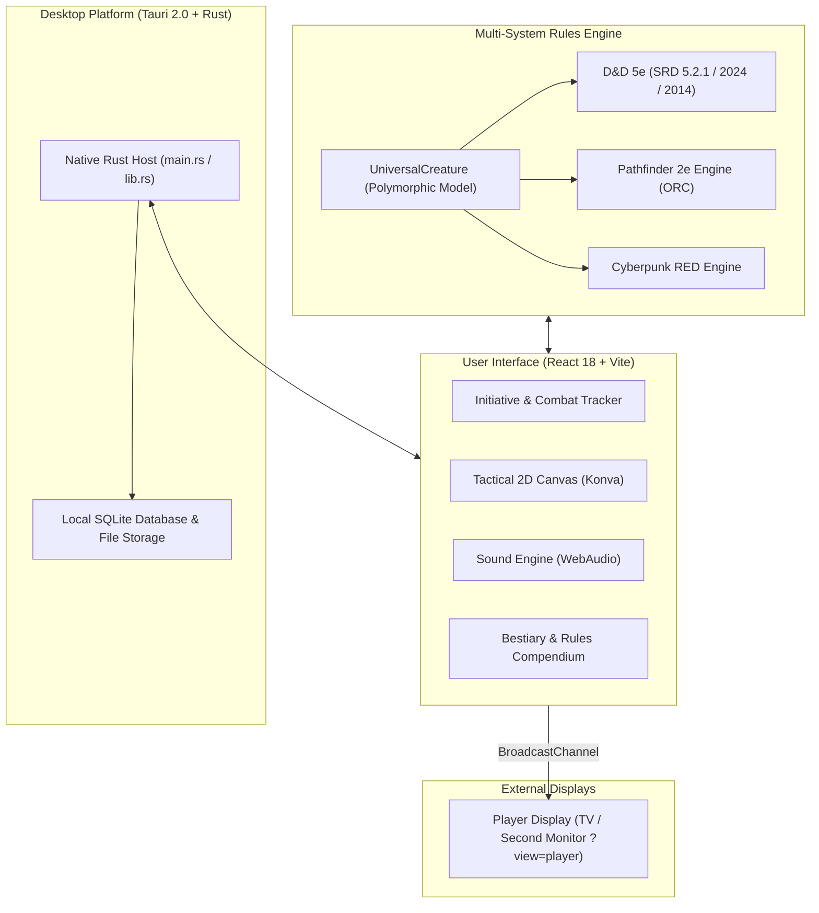

<p align="center">
  
</p>

<h1 align="center">TTRPG Helper</h1>

<p align="center">
  <strong>100% Offline-First Multi-System Virtual Tabletop & Combat Manager</strong><br>
  <em>Autonomous desktop combat tracker and session command center for Game Masters and TTRPG players</em>
</p>

<p align="center">
  
  <a href="https://discord.gg/XYQSHWVAuE"></a>
  <a href="https://www.reddit.com/r/TTRPGHelper/"></a>
  
  
  
  
  
</p>

<p align="center">
  <strong>Language / Язык:</strong>
  <a href="README.md">🇷🇺 <strong>Русский</strong></a> &bull;
  <a href="README_EN.md">🇬🇧 <strong>English</strong></a>
</p>

---

## Table of Contents

- [About the Project](#about-the-project)
- [Supported Rule Systems](#supported-rule-systems)
- [Key Features](#key-features)
  - [1. Interactive Tactical Battle Map & Player Screen](#1-interactive-tactical-battle-map--player-screen)
  - [2. Blazing Fast Keyboard Combat Controls (Numpad Hotkeys)](#2-blazing-fast-keyboard-combat-controls-numpad-hotkeys)
  - [3. Bestiary, Spells & Rules Compendium](#3-bestiary-spells--rules-compendium)
  - [4. Embedded Offline Sound Engine](#4-embedded-offline-sound-engine)
  - [5. Data Reliability, SQLite & Crash Recovery](#5-data-reliability-sqlite--crash-recovery)
- [Architecture Overview](#architecture-overview)
- [Keyboard Hotkeys Cheat Sheet](#keyboard-hotkeys-cheat-sheet)
- [Installation & Building](#installation--building)
- [Repository Structure](#repository-structure)
- [Developer Documentation](#developer-documentation)
- [Licenses & Legal Notices](#licenses--legal-notices)
- [Community & Support](#community--support)

---

## About the Project

**TTRPG Helper** is a high-performance desktop application designed for Game Masters (Dungeon Masters) and tabletop RPG players.

### Core Principles

- **100% Offline-First**: Zero reliance on external cloud servers, third-party subscriptions, or an active internet connection. All calculations, combat logs, databases, and campaign notes remain entirely local on your machine.
- **Performance (Rust + Tauri 2.0)**: Native Rust backend guarantees minimal memory footprint, instant startup, and blazing responsiveness for the React 18 frontend.
- **Swiss Neo-Glassmorphism**: Elegant dark-themed user interface with hardware-accelerated backdrop blur, calibrated typography, and distinct color-coding for different game systems.
- **Dual-Screen Setup**: Full separation between the Game Master's confidential command hub and a clean, immersive Player Display for a second monitor or TV.

---

## Supported Rule Systems

The application cleanly decouples the UI layer, the polymorphic [`UniversalCreature`](src/types/system.ts#L97-L117) model, and isolated rule engines [`SystemRuleEngine`](src/types/system.ts#L162-L179):

| Game System | Source Document / License | Status | Core Engine Mechanics | Color Palette |
| :--- | :--- | :---: | :--- | :--- |
| **D&D (SRD 5.2.1 / 2024)** | WotC SRD 5.2.1 (CC-BY-4.0) | **Ready** | 2024 rules: Weapon Mastery traits, Dazed/Incapacitated conditions, numerical exhaustion (-2/lvl), complete SRD bestiary & spells | Warm Fantasy Gold |
| **D&D (SRD 5.1 / 2014)** | WotC SRD 5.1 (CC-BY-4.0) | **Ready** | Classic 5th Edition: core classes, spell slots, classic SRD bestiary, exhaustion levels (1–6) | Warm Fantasy Gold |
| **Pathfinder 2e** | Remastered (ORC License) | **Beta** | 3-action economy per turn, 4 degrees of success (+/-10 & Nat 20/1), Perception/Stealth initiative, MAP | Stately Slate Bronze |
| **Cyberpunk RED** | Core Rules (R. Talsorian) | **In Progress** | REF + 1d10 Initiative, Ablative Armor SP by hit location (Head/Body), Humanity, wound thresholds | Neon Cyberpunk |
| **Custom / Homebrew** | User-defined rules | **Beta** | Arbitrary dice formulas, customizable resource pools, flexible condition tracks | Adaptive |

> [!NOTE] Full Openness of D&D Rules (Creative Commons)
> All game rules, spells, monster statblocks, and mechanics for D&D in TTRPG Helper are derived **strictly from the official System Reference Documents (SRD 5.2.1 and SRD 5.1)** published by Wizards of the Coast LLC under the irrevocable **Creative Commons Attribution 4.0 International License (CC-BY-4.0)**. The application does not contain proprietary Product Identity content (e.g. Beholder, Mind Flayer).

---

## Key Features

### 1. Interactive Tactical Battle Map & Player Screen

- **Coordinate Grids**:
  - Classic Square Grid.
  - Pointy-top Hexagonal Grid (`hex-pointy`).
  - Flat-top Hexagonal Grid (`hex-flat`).
  - Automatic snapping of tokens to grid centers and intersections.
- **Tokens & Miniatures**:
  - Full size support from Tiny (0.5x0.5) to Gargantuan (4x4).
  - Radial quick-action menu [`TokenQuickActions`](src/components/map/TokenQuickActions.tsx) (apply damage, healing, or toggle conditions directly on the canvas).
  - Real-time HP bar, temporary hit points display, and active status badges.
- **Dynamic Fog of War & Line of Sight**:
  - Conceals unexplored dungeon sectors and corridors.
  - Raycasting Line of Sight from party tokens with automated reveals of visible areas.
- **AoE Spell & Area Templates**:
  - Cones, Spheres/Circles, Straight Lines, and Cubes.
  - 360-degree rotation, radius adjustment in feet/grid cells, and elemental color presets.
- **Secret GM Pins & Markers**:
  - Place interactive pins on the map containing secret lore, trap DCs, and hidden surprises.
  - "Secret Pin" toggle ensures pins are visible only on the GM's screen and hidden on the Player Display.
- **Weather & Environmental Shaders**:
  - Animated canvas overlays: Heavy Rain, Snowstorm, Dense Fog, Floating Cinders & Ash.
- **Player Display**:
  - Dedicated window optimized for a secondary TV or projector (`?view=player`).
  - Automatically filters out invisible/fogged monsters, GM notes, and control sidebars.
  - Independent camera navigation for players (LMB, RMB, MMB, `Space + Drag`, scroll zoom).
  - Instant camera sync button `[ 📺 Sync to Players ]` to focus the player screen on the GM's current view.

---

### 2. Blazing Fast Keyboard Combat Controls (Numpad Hotkeys)

Run encounters at lightning speed without ever reaching for the mouse:
- **`Up / Down Arrows`** or **`J / K`**: Cycle through combatants in the initiative order.
- **`0–9`** (including the Numpad): Enter a numerical value into the action buffer.
- **`Minus (-)`**: Apply the buffered value as damage to the selected target.
- **`Plus (+)`**: Heal the selected target by the buffered amount.
- **`Slash (/)`**: Grant temporary hit points (Temp HP).
- **`Asterisk (*)`**: Roll initiative for the selected participant.
- **`Spacebar`**: Advance turn to the next combatant with automated turn timer advancement.
- **`Enter`**: Confirm the pending buffered action.
- **`Escape`**: Clear the numeric buffer or dismiss open dialogs.

---

### 3. Bestiary, Spells & Rules Compendium

- **Built-in Database**:
  - Over 300 monsters from the D&D 5e SRD 5.2.1 and 2024 rules.
  - Complete profiles for attacks, saving throws, damage resistances, vulnerabilities, and spellcasting.
  - One-click addition to the active combat encounter.
- **Interactive Rules Cheat Sheet** via **`F1`**:
  - 2024 Species & Lineages (Aasimar, Dragonborn, Dwarf, Elf, Gnome, Goliath, Halfling, Human, Orc, Tiefling).
  - 16 core Conditions with explicit mechanics and penalties.
  - Complete Combat Actions catalog (Action, Bonus Action, Reaction, Free Action).
- **Custom Pack Builder**:
  - Embedded utility [`tools/pack-builder/pack-builder.ts`](tools/pack-builder/pack-builder.ts) for compiling custom monsters, items, and rules from JSON into optimized binary bundles.

---

### 4. Embedded Offline Sound Engine

- **Multi-Channel Audio Mixer**:
  - Background atmospheric soundscapes (Tavern, Dungeon, Night Forest, Rain, Battle).
  - Continuous seamless looping with independent volume sliders for ambiance and effects.
- **Event-Driven Sound Effects (SFX)**:
  - Realistic 3D dice rolling audio.
  - Special fanfares for Critical Hits (Natural 20) and Critical Fails (Natural 1).
  - Turn bell chime and round timer warning alerts.

---

### 5. Data Reliability, SQLite & Crash Recovery

- **Local Storage Directory**:
  All campaigns, characters, custom monsters, and settings reside locally:
  ```text
  %APPDATA%/ttrpg-helper/
  ```
- **Combat Crash Recovery**:
  Every round transition, damage event, and condition update is saved asynchronously to `combat_active.json`. If closed unexpectedly, the app prompts you to resume right where you left off.
- **Daily Automated Backups**:
  The [`backupService`](src/services/backupService.ts) automatically creates `dnd2024_backup_YYYY-MM-DD.db` on first daily launch, retaining up to 7 rotating snapshots.
- **Seamless Legacy Migration**:
  On first launch, TTRPG Helper automatically discovers and imports data from previous installations (`%APPDATA%/dnd-ait/`), leaving original files completely untouched.

---

## Architecture Overview



---

## Keyboard Hotkeys Cheat Sheet

| Key | Context | Action |
| :--- | :--- | :--- |
| **`F1`** | Global | Toggle Rules Cheat Sheet modal |
| **`Down Arrow` / `J`** | Combat Tracker | Select next combatant in turn order |
| **`Up Arrow` / `K`** | Combat Tracker | Select previous combatant in turn order |
| **`Spacebar`** | Combat Tracker | Pass turn to next combatant |
| **`0` .. `9`** (Numpad) | Combat Tracker | Enter number into action buffer |
| **`-`** (Minus) | Combat Tracker | Deal buffered damage to target |
| **`+`** (Plus) | Combat Tracker | Heal buffered amount on target |
| **`/`** (Slash) | Combat Tracker | Set buffered value as Temporary HP |
| **`*`** (Asterisk) | Combat Tracker | Roll initiative for selected combatant |
| **`Enter`** | Combat Tracker | Confirm pending buffered action |
| **`Escape`** | Global | Clear buffer / Close active modal |
| **`H`** | Tactical Map | Switch to Pan Tool |
| **`V`** | Tactical Map | Switch to Select Tool |
| **`Space + Drag`** | Tactical Map | Pan the battle map freely |
| **`RMB` / `MMB`** | Tactical Map | Pan the battle map with mouse |

---

## Installation & Building

### For End Users (Packaged Installer)

1. Download **`TTRPG_Helper_Setup.exe`** from the [GitHub Releases](https://github.com/AlexeyMaster67/TTRPG-Helper/releases) page.
2. Launch the installer and follow the setup wizard.

---

### For Developers (Building from Source)

#### Prerequisites:
- **Node.js**: version `18.x` or `20.x+` (LTS)
- **Rust & Cargo**: latest stable release ([rustup.rs](https://rustup.rs/))
- **Visual Studio C++ Build Tools** (for compiling native Rust dependencies on Windows)

#### Step-by-Step Instructions:

1. **Clone the repository:**
   ```bash
   git clone https://github.com/AlexeyMaster67/TTRPG-Helper.git
   cd TTRPG-Helper
   ```

2. **Install Node dependencies:**
   ```bash
   npm install
   ```

3. **Build content packs:**
   ```bash
   npm run build:packs
   ```

4. **Launch development mode with Hot-Reload:**
   ```bash
   # Run frontend in browser (port 5173)
   npm run dev

   # Run complete desktop Tauri application
   npm run tauri dev
   ```

5. **Execute automated unit tests (392 tests):**
   ```bash
   npm test
   ```

6. **Compile production installer (Windows x64 NSIS Setup):**
   ```bash
   npm run tauri build
   ```
   The standalone installer executable will be located in:
   ```text
   src-tauri/target/release/bundle/nsis/TTRPG_Helper_Setup.exe
   ```

---

## Repository Structure

```text
├── src/                          # Frontend source code (React 18 + TypeScript)
│   ├── components/               # UI components
│   │   ├── combat/               # Turn timers, round tracker, dice roller
│   │   ├── map/                  # Tactical canvas (Konva), tokens, AoE templates
│   │   ├── player/               # Player Display view (?view=player)
│   │   ├── tools/                # Rules cheat sheet, Pack Builder, calculators
│   │   ├── tracker/              # Combatant cards, bestiary, library
│   │   └── ui/                   # Atomic UI primitives (buttons, dialogs, HP bars)
│   ├── systems/                  # Multi-system rule engines (D&D 5e, PF2e, Cyberpunk)
│   ├── stores/                   # Global state management (Zustand / Context)
│   ├── services/                 # Database, backup, migration, and audio services
│   ├── types/                    # TypeScript interfaces and universal model types
│   └── tests/                    # Automated unit and integration test suites
├── src-tauri/                    # Native Rust backend (Tauri 2.0)
│   ├── src/main.rs               # Rust entry point, command registration, windows
│   ├── capabilities/             # Tauri v2 security policies and permissions
│   ├── Cargo.toml                # Rust dependencies (tauri, rusqlite, serde, etc.)
│   └── tauri.conf.json           # Window definitions, bundler config, metadata
├── public/                       # Static assets (sounds, icons, default tokens)
├── docs/                         # Technical documentation and guides
│   ├── architecture.md           # Architectural overview of multi-system core
│   └── adding-a-system.md        # Guide on adding a new TTRPG rule system
├── tools/                        # Content compilation and packaging scripts
│   ├── pack-builder/             # Content pack compiler (TypeScript)
│   └── scripts/                  # Installer build helper scripts
└── index.html                    # Web application mount point
```

---

## Developer Documentation

- [Architecture Overview](docs/architecture.md)
- [How to Add a New Game System](docs/adding-a-system.md)

---

## Licenses & Legal Notices

- **Application Source Code** is licensed under the **[MIT License](LICENSE)**.
- **D&D 5e SRD 5.1 / 5.2.1** materials are used under the **[Creative Commons Attribution 4.0 International License (CC-BY-4.0)](https://creativecommons.org/licenses/by/4.0/legalcode)** by Wizards of the Coast LLC.
- **Pathfinder 2e Remastered** materials are used under the **[Open RPG Creative License (ORC)](https://paizo.com/orclicense)** by Paizo Inc.
- **Cyberpunk RED** is based on open materials published by R. Talsorian Games.

---

## Legal Information & Fan Content Policy

### SRD 5.2.1 / 5.1 Creative Commons Attribution
> **Official SRD Notice:**  
> *This work includes material taken from the System Reference Document 5.2.1 (“SRD 5.2.1”) and System Reference Document 5.1 (“SRD 5.1”) by Wizards of the Coast LLC, available under the Creative Commons Attribution 4.0 International License (CC-BY-4.0).*  
> All D&D rules, spells, and monster statistics included in this application are derived strictly from the official open SRD 5.2.1 (2024 revision) and SRD 5.1 (classic 2014 edition), distributed royalty-free worldwide under CC-BY-4.0.

### Wizards of the Coast Fan Content Policy
> **Wizards of the Coast Notice:**  
> TTRPG Helper is unofficial Fan Content permitted under the Wizards of the Coast Fan Content Policy. Not approved or endorsed by Wizards. Portions of the materials used are property of Wizards of the Coast LLC. ©Wizards of the Coast LLC.

This application is an independent, non-commercial, open-source fan project created by and for the tabletop RPG community.

### Trademarks & Nominative Fair Use
* **Dungeons & Dragons**, **D&D**, associated logos, and related marks are registered trademarks of **Wizards of the Coast LLC** (a subsidiary of Hasbro, Inc.).
* **Pathfinder** and associated logos are registered trademarks of **Paizo Inc.**.
* **Cyberpunk RED** is a trademark of **R. Talsorian Games, Inc.**.

All references to specific gaming systems, publishers, and trademarks are used strictly for descriptive purposes to indicate system compatibility under nominative fair use and do not imply endorsement, sponsorship, or affiliation by the respective trademark owners.

### DMCA & Copyright Inquiries
If you are a copyright holder and believe that any material in this repository infringes upon your rights or exceeds the scope of the Fan Content Policy / Creative Commons licenses, please open an issue in the [GitHub Issues](https://github.com/AlexeyMaster67/TTRPG-Helper/issues) tracker. Inquiries are handled with urgency, and any contested material will be promptly addressed.

---

## Community & Support

Join the official **TTRPG Helper** Discord and Reddit community to chat with other GMs, find games, discuss systems (D&D 2024, Pathfinder 2e, Cyberpunk RED), and connect directly with the developer:

<p align="center">
  <a href="https://discord.gg/XYQSHWVAuE">
    
  </a>
  &nbsp;
  <a href="https://www.reddit.com/r/TTRPGHelper/">
    
  </a>
</p>


