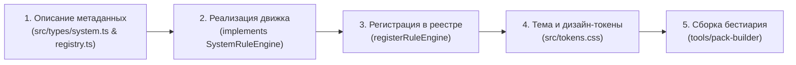

# Руководство: Добавление новой игровой системы в TTRPG Helper

В этом пошаговом руководстве подробно описано, как интегрировать новую систему настольных ролевых игр (например, *Call of Cthulhu*, *Warhammer Fantasy Roleplay*, *Alien RPG*, *Fate* или собственный авторский хак) в модульное ядро **TTRPG Helper**.

Архитектура системы построена на слабой связности: движок правил изолирован от пользовательского интерфейса, а сущности персонажей и монстров представлены полиморфной моделью [`UniversalCreature`](src/types/system.ts#L97-L117).

---

## 🏛️ Архитектурный обзор

Интеграция новой системы включает 4 обязательных шага и 1 опциональный (пакет контента):



---

## Шаг 1: Описание метаданных системы (`SystemMetadata`)

Метаданные объявляют идентификатор системы, поддерживаемые механики и связывают её с визуальной темой оформления.

Откройте [`src/types/system.ts`](src/types/system.ts) и проверьте интерфейсы [`SystemFamily`](src/types/system.ts#L6), [`ActionEconomyType`](src/types/system.ts#L10-L15) и [`SystemFeatures`](src/types/system.ts#L16-L24):

```typescript
export type SystemFamily = 'dnd5e' | 'pathfinder' | 'cyberpunk' | 'custom' | 'call_of_cthulhu';

export interface SystemFeatures {
  spellSlots: boolean;          // Наличие слотов заклинаний (как в D&D/PF)
  weaponMastery: boolean;       // Свойства мастерства оружия (D&D 2024)
  armorAblation: boolean;       // Снижение показателя брони при пробитии (Cyberpunk RED SP)
  degreesOfSuccess: boolean;    // Четыре степени успеха ±10 (Pathfinder 2e)
  deathSaveTrack: boolean;      // Наличие трека спасбросков от смерти
  humanityTrack: boolean;       // Наличие трека человечности/рассудка
  actionEconomy: ActionEconomyType; // 'action_bonus_reaction' | 'three_action' | 'move_and_action' | 'action_points'
}
```

Затем подготовьте объект метаданных в [`src/systems/registry.ts`](src/systems/registry.ts):

```typescript
export const MY_SYSTEM_METADATA: SystemMetadata = {
  id: 'my_custom_system',
  name: 'My Custom TTRPG',
  shortName: 'MCS',
  family: 'custom',
  edition: '1st Edition',
  version: '1.0.0',
  status: 'beta', // 'stable' | 'beta' | 'wip' | 'planned'
  themeId: 'my-custom-theme',
  description: 'Краткое описание механики и ключевых особенностей системы для мастера.',
  shortDescription: 'Быстрые проверки 2d6, зоны ранений',
  author: 'Your Studio / Community',
  supportedFeatures: {
    spellSlots: false,
    weaponMastery: false,
    armorAblation: true,
    degreesOfSuccess: false,
    deathSaveTrack: false,
    humanityTrack: true,
    actionEconomy: 'action_points',
  },
};
```

---

## Шаг 2: Реализация интерфейса `SystemRuleEngine`

Создайте отдельную папку системы: `src/systems/<system_id>/` (например, `src/systems/my_custom_system/engine.ts`).

Класс системы обязан реализовывать интерфейс [`SystemRuleEngine`](src/types/system.ts#L162-L179):

```typescript
export interface SystemRuleEngine {
  metadata: SystemMetadata;

  // 1. Расчет инициативы и тай-брейкера
  calculateInitiative(creature: UniversalCreature, rollOverride?: number): InitiativeResult;

  // 2. Проверка характеристик и навыков
  resolveCheck(statKey: string, creature: UniversalCreature, dc?: number, context?: RollContext): CheckResult;

  // 3. Расчет попадания атаки по существу
  calculateHit(attackRoll: number, target: UniversalCreature, isCritRoll?: boolean): HitCalculationResult;

  // 4. Пайплайн нанесения урона, брони и состояний
  applyDamage(
    target: UniversalCreature,
    rawDamage: number,
    damageType: string,
    zone?: string
  ): { updatedCreature: UniversalCreature; result: DamageResolutionResult };

  // 5. Логика отдыха и восстановления ресурсов (опционально)
  applyRest?(
    creatures: UniversalCreature[],
    restType: 'short' | 'long' | 'encounter'
  ): UniversalCreature[];
}
```

### Разбор на живых примерах из кодовой базы:

#### Пример A: Инициатива
- **Pathfinder 2e** ([`Pathfinder2eEngine.calculateInitiative`](src/systems/pathfinder2e/pathfinder2e.ts#L63-L76)):
  Использует проверку Восприятия (Perception) на 1d20. В качестве тай-брейкера берется дробная часть бонуса `bonus / 100`:
  ```typescript
  calculateInitiative(creature: UniversalCreature, rollOverride?: number): InitiativeResult {
    const stats = creature.stats || {};
    const bonus = stats.perception ?? stats.stealth ?? stats.wisMod ?? 0;
    const rolledValue = typeof rollOverride === 'number' ? rollOverride : rollDie(20);
    const tieBreaker = Number((bonus / 100).toFixed(2));
    const total = Number((rolledValue + bonus + tieBreaker).toFixed(2));
    return { total, rolledValue, bonus, tieBreaker };
  }
  ```

- **Cyberpunk RED** ([`CyberpunkRedEngine.calculateInitiative`](src/systems/cyberpunk_red/cyberpunkRed.ts#L61-L74)):
  Использует характеристику Рефлексов (REF) на кубике 1d10 с тай-брейком `REF / 100`:
  ```typescript
  calculateInitiative(creature: UniversalCreature, rollOverride?: number): InitiativeResult {
    const stats = creature.stats || {};
    const ref = stats.ref ?? stats.REF ?? 0;
    const rolledValue = typeof rollOverride === 'number' ? rollOverride : rollDie(10);
    const tieBreaker = Number((ref / 100).toFixed(2));
    return {
      total: Number((rolledValue + ref + tieBreaker).toFixed(2)),
      rolledValue,
      bonus: ref,
      tieBreaker,
    };
  }
  ```

#### Пример B: Проверки навыков и степени успеха
- **Pathfinder 2e (4 степени успеха)** ([`evaluateDegreeOfSuccess`](src/systems/pathfinder2e/pathfinder2e.ts#L88-L113)):
  - Разница $\ge +10 \rightarrow$ *Критический успех*
  - Разница $\ge 0 \rightarrow$ *Успех*
  - Разница $< 0 \rightarrow$ *Провал*
  - Разница $\le -10 \rightarrow$ *Критический провал*
  - Натуральная 20 повышает ранг на 1 ступень; натуральная 1 понижает на 1 ступень.

- **Cyberpunk RED (Взрывающиеся дайсы и крит-провалы)** ([`resolveCheck`](src/systems/cyberpunk_red/cyberpunkRed.ts#L106-L157)):
  - При выпадении **10**: бросается дополнительный d10 и прибавляется к результату (взрыв).
  - При выпадении **1**: бросается дополнительный d10 и вычитается из результата (осечка).

#### Пример C: Пайплайн урона и брони
- **Cyberpunk RED (Зоны попадания и абляция SP)** ([`applyDamage`](src/systems/cyberpunk_red/cyberpunkRed.ts#L228-L342)):
  1. Определяется зона попадания (`zone: 'head' | 'body'`).
  2. Сравнивается урон с показателем защиты зоны `sp = target.tracks['armor_sp_head']?.current`.
  3. Если `rawDamage > sp`:
     - Избыточный урон вычитается из HP цели (в голову урон удваивается по правилам CP Red).
     - Броня в зоне изнашивается (SP уменьшается на 1: `armorDamage = 1`).
  4. Если текущее здоровье падает ниже 50%, на существо накладывается состояние `seriously_wounded` со штрафом -2 к действиям.

```typescript
// Шаблон метода applyDamage для вашей системы:
applyDamage(
  target: UniversalCreature,
  rawDamage: number,
  damageType: string,
  zone?: string
): { updatedCreature: UniversalCreature; result: DamageResolutionResult } {
  const updated = JSON.parse(JSON.stringify(target)) as UniversalCreature;
  
  // 1. Учет иммунитетов и сопротивлений
  let effectiveDamage = rawDamage;
  if (target.defenses.damageImmunities.includes(damageType)) {
    effectiveDamage = 0;
  } else if (target.defenses.damageResistances.includes(damageType)) {
    effectiveDamage = Math.floor(effectiveDamage / 2);
  }

  // 2. Поглощение временными очками здоровья (Temp HP)
  const currentTemp = updated.resources.hp?.temp ?? 0;
  const tempAbsorbed = Math.min(currentTemp, effectiveDamage);
  if (updated.resources.hp) {
    updated.resources.hp.temp = currentTemp - tempAbsorbed;
  }
  const remainingDamage = effectiveDamage - tempAbsorbed;

  // 3. Вычитание из основного пула здоровья
  const currentHp = updated.resources.hp?.current ?? 0;
  const newHp = Math.max(0, currentHp - remainingDamage);
  if (updated.resources.hp) {
    updated.resources.hp.current = newHp;
  }

  return {
    updatedCreature: updated,
    result: {
      hpDamage: remainingDamage,
      tempHpAbsorbed: tempAbsorbed,
      armorDamage: 0,
      appliedToZone: zone,
      effectiveDamage,
      isCriticalWound: newHp === 0,
      statusEffectsApplied: newHp === 0 ? ['unconscious'] : [],
    },
  };
}
```

---

## Шаг 3: Регистрация системы в `SYSTEM_REGISTRY`

1. Откройте [`src/systems/registry.ts`](src/systems/registry.ts).
2. Зарегистрируйте метаданные в объекте `SYSTEM_REGISTRY`:
   ```typescript
   import { MyCustomSystemEngine } from './my_custom_system/engine';

   export const SYSTEM_REGISTRY: Record<string, SystemMetadata> = {
     // ... существующие системы (srd_5_2_1, dnd5e_2024, pathfinder2e, cyberpunk_red)
     my_custom_system: MY_SYSTEM_METADATA,
   };
   ```
3. Зарегистрируйте экземпляр движка через [`registerRuleEngine`](src/systems/registry.ts#L12-L14):
   ```typescript
   export const myCustomEngine = new MyCustomSystemEngine();
   registerRuleEngine(myCustomEngine);
   ```
4. Экспортируйте модуль в [`src/systems/index.ts`](src/systems/index.ts).

После этого система автоматически появится в карточках выбора правил в диалоге **Настройки** $\rightarrow$ **Игровая система**!

---

## Шаг 4: Темизация и дизайн-токены в `src/tokens.css`

TTRPG Helper использует единый швейцарский нео-глассморфизм с семантической защитой. Добавьте стилизацию для атрибута `data-system="my-custom-theme"` в [`src/tokens.css`](src/tokens.css):

```css
/* ==========================================================================
   THEME: MY CUSTOM SYSTEM
   `<html data-system="my-custom-theme">`
   ========================================================================== */
html[data-system="my-custom-theme"],
[data-system="my-custom-theme"] {
  --theme-id: 'my-custom-theme';

  /* Фоны поверхностей и канваса */
  --bg-canvas: #0a0d14;
  --bg-canvas-subtle: #0f141e;
  --bg-surface: rgba(16, 22, 34, 0.82);
  --bg-surface-solid: #101622;
  --bg-card: rgba(22, 30, 46, 0.7);
  --bg-card-hover: rgba(30, 42, 64, 0.88);
  --bg-card-active: rgba(38, 54, 82, 0.95);
  --bg-overlay: rgba(6, 9, 15, 0.85);

  /* Глассморфизм и границы */
  --glass-bg: var(--bg-surface);
  --glass-bg-elevated: rgba(26, 36, 56, 0.88);
  --glass-border: rgba(56, 189, 248, 0.18);
  --glass-border-hover: rgba(56, 189, 248, 0.4);
  --glass-border-accent: rgba(56, 189, 248, 0.5);
  --glass-border-gold: var(--glass-border-accent);
  --glass-shadow: 0 12px 32px -4px rgba(0, 0, 0, 0.7);

  /* Основной фирменный акцент */
  --accent: #38bdf8;           /* Небесно-голубой */
  --accent-hover: #7dd3fc;
  --accent-active: #0284c7;
  --accent-text: #041019;
  --accent-subtle: rgba(56, 189, 248, 0.12);
  --accent-glow: 0 0 18px rgba(56, 189, 248, 0.35);

  /* Геометрия скруглений */
  --radius-xs: 4px;
  --radius-sm: 8px;
  --radius-md: 12px;
  --radius-card: 14px;
  --radius-lg: 16px;
  --radius-xl: 20px;
}
```

> [!CAUTION]
> **Золотое правило темы:**
> **Никогда** не переопределяйте семантические переменные:
> - `--semantic-damage` (`#e5484d`)
> - `--semantic-heal` (`#3dd68c`)
> - `--semantic-save` (`#4f9cf9`)
>
> Они обязаны быть одинаковыми во всех системах для сохранения мышечной памяти мастера!

---

## Шаг 5: Сборка пакета существ системы (`Content Pack`)

Чтобы пользователи могли использовать монстров и NPC для вашей системы, создайте манифест пакета:

1. Создайте JSON-файл с существами в каталоге `tools/pack-builder/my_system_creatures.json`. Каждое существо должно соответствовать схеме [`UniversalCreature`](src/types/system.ts#L97-L117):
   ```json
   [
     {
       "id": "my_monster_1",
       "name": "Кибергончая",
       "system_id": "my_custom_system",
       "system_version": "1.0.0",
       "is_player": false,
       "stats": { "hp": 25, "ac": 13, "speed": 40 },
       "resources": {
         "hp": { "current": 25, "max": 25 }
       },
       "tracks": {},
       "conditions": [],
       "defenses": {
         "damageImmunities": ["poison"],
         "damageResistances": [],
         "damageVulnerabilities": ["lightning"],
         "conditionImmunities": ["poisoned"],
         "damageReductions": {}
       },
       "actions": [
         {
           "id": "bite",
           "name": "Укус",
           "actionType": "action",
           "attackBonus": 5,
           "damageDice": "2d6+3",
           "damageType": "piercing"
         }
       ]
     }
   ]
   ```

2. Запустите компилятор пакетов:
   ```bash
   npm run build:packs
   ```
   Утилита сформирует бинарный файл `packs/my_custom_system.pack` и манифест `packs/my_custom_system.pack.json`.

---

## 🧪 Написание юнит-тестов системы

Для проверки корректности механик напишите тест в каталоге `tests/systems/my_custom_system.test.ts`:

```typescript
import { describe, it, expect } from 'vitest';
import { MyCustomSystemEngine } from '../../src/systems/my_custom_system/engine';

describe('MyCustomSystemEngine', () => {
  const engine = new MyCustomSystemEngine();

  it('корректно рассчитывает инициативу с тай-брейкером', () => {
    const creature: any = { stats: { initiative: 4 } };
    const res = engine.calculateInitiative(creature, 10);
    expect(res.rolledValue).toBe(10);
    expect(res.bonus).toBe(4);
    expect(res.tieBreaker).toBe(0.04);
    expect(res.total).toBe(14.04);
  });

  it('корректно вычитает урон с учетом Temp HP', () => {
    const target: any = {
      resources: { hp: { current: 20, max: 20, temp: 5 } },
      defenses: { damageImmunities: [], damageResistances: [] },
    };
    const { updatedCreature, result } = engine.applyDamage(target, 8, 'slashing');
    expect(result.tempHpAbsorbed).toBe(5);
    expect(result.hpDamage).toBe(3);
    expect(updatedCreature.resources.hp.current).toBe(17);
    expect(updatedCreature.resources.hp.temp).toBe(0);
  });
});
```

Запустите тесты:
```bash
npm run test
```

---

## 🏁 Заключение

Благодаря контракту [`SystemRuleEngine`](src/types/system.ts#L162-L179) и реестру [`SYSTEM_REGISTRY`](src/systems/registry.ts) добавление новой системы в **TTRPG Helper** не требует переписывания интерфейса боя, карты, трекера инициативы или сетевого кода. Вы фокусируетесь исключительно на математике и правилах вашей любимой НРИ!
