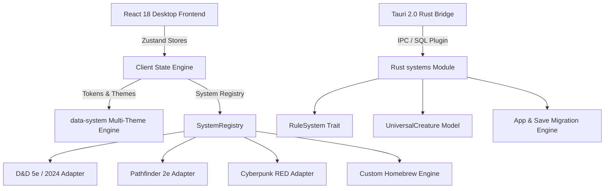

# TTRPG Helper: Multi-System Architecture

## 1. Overview & Vision

**TTRPG Helper** is an offline, multi-system tabletop RPG combat and campaign tracker desktop application built with **Rust (Tauri 2.0)** and **React 18 + TypeScript**.

This architecture decouples the legacy D&D 5e-specific mechanics into a flexible, extensible **Multi-System Core** supporting:
- **D&D 5e** (SRD 5.2.1, 2014 Classic, 2024 Revised)
- **Pathfinder 2e** (3-action economy, 4 degrees of success $\pm 10$, Perception initiative)
- **Cyberpunk RED** (REF + 1d10, SP Armor by Body Zone with ablation, Humanity, Serious/Critical Injury thresholds)
- **Custom / Homebrew Systems** (arbitrary dice, customizable resource tracks)



---

## 2. Universal Creature Model

Rather than forcing every game into D&D's Armor Class and Hit Points, every combatant and character is represented by the **`UniversalCreature`** model.

### 2.1 Core Attributes

| Field | Type | Description |
| :--- | :--- | :--- |
| `id` | `String` | Unique UUID |
| `name` | `String` | Display name |
| `system_id` | `String` | ID of the ruleset (e.g., `dnd5e_2024`, `cyberpunk_red`) |
| `system_version` | `String` | Semantic version of the ruleset |
| `is_player` | `bool` | Flag separating PCs from NPCs/monsters |
| `stats` | `Map<String, f64>` | Numerical core attributes (e.g., `str, dex` for D&D; `ref, tech, cool` for Cyberpunk) |
| `resources` | `Map<String, ResourcePool>` | Pools with `{ current, max, temp, reset_on }` (e.g., HP, Humanity, Luck) |
| `tracks` | `Map<String, Track>` | Progressive step tracks (e.g., Death Saves, Armor SP Head/Body, Wound Thresholds) |
| `conditions` | `Vec<ConditionInstance>` | Applied status effects with duration, severity levels, and notes |
| `defenses` | `CreatureDefenses` | Immunities, resistances, vulnerabilities, and flat damage reductions |
| `actions` | `Vec<CreatureAction>` | Attacks, spells, programs, or abilities with action-economy tags |

---

## 3. Rust `RuleSystem` Trait

Located in `src-tauri/src/systems/system_trait.rs`:

```rust
pub trait RuleSystem: Send + Sync {
    fn metadata(&self) -> &SystemMetadata;
    fn calculate_initiative(&self, creature: &UniversalCreature, roll_override: Option<i32>) -> InitiativeResult;
    fn resolve_check(&self, stat_key: &str, creature: &UniversalCreature, dc: Option<i32>, context: &RollContext) -> CheckResult;
    fn calculate_hit(&self, attack_roll: i32, target: &UniversalCreature, is_crit_roll: bool) -> HitCalculationResult;
    fn apply_damage(&self, target: &mut UniversalCreature, raw_damage: i64, damage_type: &str, zone: Option<&str>) -> DamageResolutionResult;
    fn apply_rest(&self, creatures: &mut [UniversalCreature], rest_type: RestType) -> RestResult;
}
```

---

## 4. Multi-System Theme Engine

Themes are triggered on the root document via `<html data-system="...">` without modifying semantic indicators:
- **`--semantic-damage: #e5484d`** (Always Red)
- **`--semantic-heal: #3dd68c`** (Always Green)
- **`--semantic-save: #4f9cf9`** (Always Blue)

| System ID | Theme Identity | Accent | Surface / Background | Radii |
| :--- | :--- | :--- | :--- | :--- |
| `dnd5e*` | Warm Fantasy | Gold `#f5b920` | Obsidian `#090b10` | 14–20px |
| `cyberpunk_red` | Neon Cyber | Yellow `#fcee0a` + Cyan `#00f0ff` | Dark High-Tech `#07070a` + Scanlines | 2–4px |
| `pathfinder2e` | Stately Slate | Bronze `#c28f47` | Deep Teal `#0b1214` | 12–16px |

---

## 5. Campaign Immutability & Migration Rules

1. **Campaign Locking**: Each campaign record persistently stores `system_id` and `system_version`. Once a campaign is created, changing its system is disallowed to prevent data corruption. Users are provided an explicit action: *"Создать копию кампании в другой системе"*.
2. **App Directory Auto-Migration**: Legacy `%APPDATA%/dnd-ait/` directories are automatically detected and copied to `%APPDATA%/ttrpg-helper/` on first startup, backed up with `migration_log.json`.
